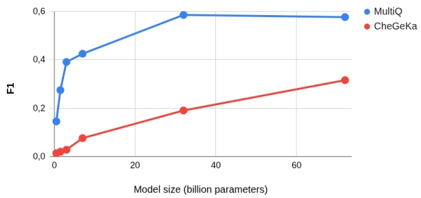
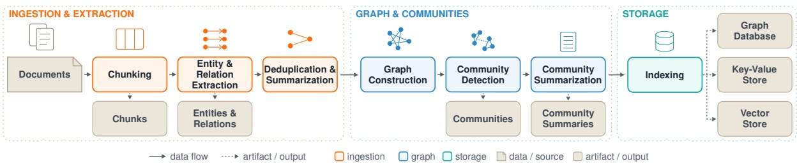
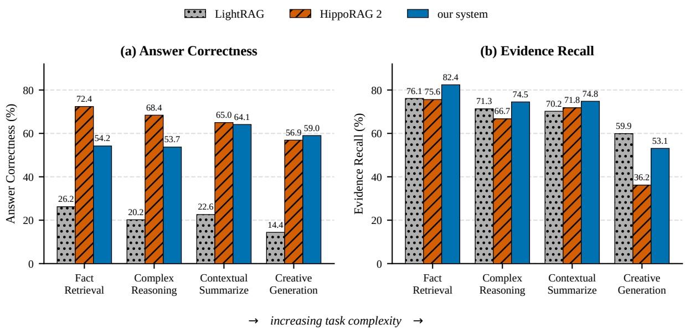
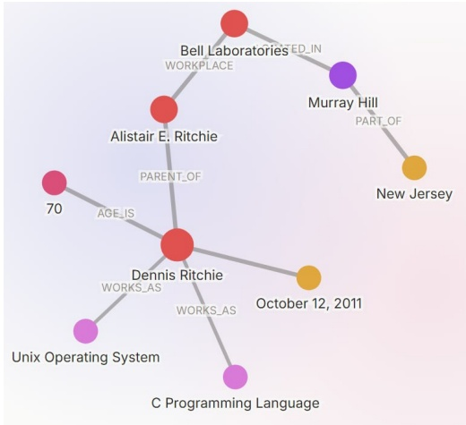

# RAGU: A Multi-Step GraphRAG Engine with a Compact Domain-Adapted LLM

**Mikhail Komarov**1,∗**Ivan Bondarenko**2,∗ **Stanislav Shtuka**1,3 **Oleg Sedukhin**† **Roman Shuvalov**1 **Yana Dementyeva**2 **Matvey Solovyov**1 **Nikolay O. Nikitin**1

1ITMO University 2Novosibirsk State University 3Far Eastern Federal University †Independent Researcher ∗Equal contribution i.bondarenko@g.nsu.ru

## Abstract

Graph retrieval-augmented generation (GraphRAG) enhances large language models with structured knowledge, yet existing systems construct knowledge graphs in a single extraction pass, producing noisy entities and brittle retrieval. RAGU, an open-source modular GraphRAG engine, addresses this by separating extraction from consolidation: entities and relations pass through two-stage typed extraction, DBSCAN-backed deduplication, LLM summarization, and Leiden community detection. A key insight motivates a compact extractor: the skills an in-pipeline LLM needs—comprehension, extraction, reasoning over context—are language skills that grow only weakly with model size, unlike factual world knowledge. Accordingly, we train Meno-Lite-0.1, a 7 B model optimized for language skills, which outperforms Qwen2.5-32B on knowledgegraph construction (+12.5% relative harmonic mean) and matches it on English GraphRAG tasks. On GraphRAG-Bench (Medical), RAGU retrieves the most complete context at every factoid level (evidence recall up to 0.84 vs. ≤0.76) and overtakes HippoRAG 2 on synthesis tasks; on multi-hop factoid QA, the apparent HippoRAG 2 advantage is shown to be largely an answer-format artifact. RAGU is installable via pip install graph\_ragu, runs on a single GPU, and is released under MIT license. The source code is publicly available at [https://github.com/RaguTeam/RAGU](https://github.com/RaguTeam/RAGU), and the Meno-Lite-0.1 model can be obtained from [https://huggingface.co/bond005/meno-lite-0.1](https://huggingface.co/bond005/meno-lite-0.1).

## 1 Introduction

Retrieval-augmented generation (RAG) grounds large language models (LLMs) in external knowledge (Lewis et al., 2020; Gao et al., 2023). Traditional RAG retrieves flat chunks without capturing cross-document entity relationships. Graph

RAG (GraphRAG) (Edge et al., 2024; Guo et al., 2025; Gutiérrez et al., 2025) addresses this by building a knowledge graph and using graph traversal during retrieval, but practical adoption faces three obstacles.

**Obstacle 1: Single-pass extraction.** Current systems treat knowledge graph construction as a single LLM extraction pass, producing noisy, duplicated entities with no mechanism to consolidate information across chunks.

**Obstacle 2: Dependence on expensive LLMs.** Extraction quality determines graph quality, so practitioners default to large API models (GPT-4-class). This rests on a false premise: the capabilities an LLM needs inside a RAG pipeline—comprehension, extraction, reasoning over context—are language skills, not factual recall. As we show next, language skills grow weakly with model size, while world knowledge scales steeply. A compact, skill-oriented model is therefore sufficient.

**Obstacle 3: Engineering immaturity.** Many open-source frameworks suffer from installation failures or unsafe code paths (e.g., eval() on raw LLM output). A GraphRAG engine should be both semantically strong and engineerable: installable, testable, and deployable on cost-effective hardware.

**Language/World Knowledge Hypothesis.** We hypothesize that **world knowledge** scales nearlinearly with parameter count, whereas **language skills** scale markedly more slowly. Figure 1 tests this on the Qwen2.5-Instruct family (Yang et al., 2024): on CheGeKa (Taktasheva et al., 2022) (world-knowledge quiz), F1 increases 21.1× from 0.5 B to 72 B, while on MultiQ (all facts in-context), it increases only 4×. In a GraphRAG pipeline, the LLM extracts entities, summarizes descriptions, and generates answers from context—all language skills. This prediction motivates a compact extractor.

Figure 1: Effect of model size on world-knowledge (CheGeKa) vs. language-skill (MultiQ) tasks in the Qwen2.5-Instruct family (F1 scores on MERA (Fenogenova et al., 2024)). CheGeKa F1 grows 21.1× from 0.5 B to 72 B; MultiQ only 4×. Log-linear slopes: 0.65 vs. 0.26.

We address all three obstacles with two artifacts, released under open licenses:

1. **Meno-Lite-0.1**, a 7 B model fine-tuned from RuadaptQwen2.5-7B (Tikhomirov and Chernyshev, 2025) for RAG-oriented language skills over the NEREL schema (Loukachevitch et al., 2021). It outperforms Qwen2.5-32B on KG construction (+12.5% harmonic mean) and rivals models up to ∼4× larger.

2. **RAGU**, a modular multi-step GraphRAG engine whose pipeline separates extraction from consolidation—two-stage typed extraction, DBSCAN-backed summarization, Leiden community detection—yielding cleaner and more connected knowledge graphs. It is installable via pip install graph\_ragu and runs on a single GPU.

RAGU differs from prior systems—Microsoft GraphRAG (Edge et al., 2024), LightRAG (Guo et al., 2025), HippoRAG 2 (Gutiérrez et al., 2025), Wikontic (Chepurova et al., 2026)—by introducing an explicit multi-step consolidation stage and by targeting engineering maturity.

## 2 System Description

## 2.1 Multi-Step Graph Construction

RAGU processes documents through six configurable stages (Figure 2):

**Step 1: Chunking.** Three strategies: SimpleChunker (fixed-size overlapping chunks), SemanticTextChunker (embedding-based split points), and SmartSemanticChunker (cross-encoder reranking).

**Step 2: Two-stage extraction.** Unlike singlepass systems, RAGU separates entity extraction (Stage 1) from relation extraction (Stage 2). Entities are first extracted and validated against the NEREL schema (29 entity types, 49 relation types), then fed back as constraints: every source\_entity and target\_entity in a relation must match a validated entity name. This eliminates spurious entity–relation mismatches. Optional in-context-learning (ICL) examples are injected at both stages, selected by semantic, BM25, hybrid, or random strategies.

**Step 3: Consolidation.** EntitySummarizer groups entities by (name, type) and—for entities with many duplicate mentions—applies DBSCAN clustering and LLM summarization. RelationSummarizer follows the same pattern. Reducing noise before community detection produces a cleaner graph—the step absent from single-pass systems like LightRAG.

**Steps 4–6: Community detection, summarization, refinement.** Hierarchical Leiden clustering partitions the deduplicated graph; an LLM generates structured community reports (title, summary, findings); pluggable modules (e.g., RemoveIsolatedNodes) optionally refine.

## 2.2 Search Engines

RAGU provides five engines: **LocalSearch** (vectorsimilarity entity retrieval expanded to relations and chunks), **GlobalSearch** (LLM-rated community summarization), **NaiveSearch** (standard vector RAG), **MixSearch** (parallel multi-engine), and **QueryPlanEngine** (DAG decomposition). All support cross-encoder reranking and hybrid dense+sparse retrieval via Qdrant.

## 2.3 Engineering and Deployment

RAGU is a production-ready Python package (see Appendix A for a comparison with HippoRAG 2). (i) A three-tier storage abstraction (graph/KV/vector) with lifecycle callbacks enables backend swapping (NetworkX→Neo4j, NanoVDB→Qdrant). (ii) An async-first API with bounded concurrency provides production-safe throughput. (iii) Structured LLM outputs are validated through Pydantic v2, removing manual JSON post-processing and preventing code injection. (iv) Incremental upsert/update/delete with deterministic hash-based IDs and merge policies, plus a consistency auditor verifying cross-store integrity. ∼374 tests and a deterministic mock LLM server enable CI without API keys. The system supports single-GPU deployment with a 7 B extraction model.

Figure 2: End-to-end indexing pipeline. Documents are chunked, entities and relations are extracted under the NEREL schema, deduplicated and summarized, then grouped into communities via Leiden clustering. All artifacts persist across three swappable storage tiers (graph database, key-value store, vector store). Solid arrows indicate data flow between pipeline stages; dashed arrows indicate artifacts produced at each stage.

## 2.4 Compact Model: Meno-Lite-0.1

Meno-Lite-0.1 (Bondarenko et al., 2026) is derived from RuadaptQwen2.5-7B-Lite-Beta (Tikhomirov and Chernyshev, 2025) through continued pre-training (1.3B tokens, Russian+English educational/scientific texts) and supervised fine-tuning (50M tokens) covering NEREL-based extraction (Loukachevitch et al., 2021), multi-hop QA (Tang and Yang, 2024; Katsis et al., 2025), and query logs. The critical distinction from generalpurpose LLMs: instructions teach the model to use context rather than recall facts—investing compute in language skills, not world knowledge. Key properties: 128K context window (passkey retrieval 0.98 at 128K), 47% better tokenizer efficiency than vanilla Qwen2.5 on Russian text (3.77 vs. 2.57 chars/token), and single-consumer-GPU deployment via vLLM (Kwon et al., 2023). The model and training details are documented in the public model card at [https://huggingface.co/bond005/meno-lite-0.1](https://huggingface.co/bond005/meno-lite-0.1).

## 3 Evaluation

## 3.1 Setup

We evaluate on four GraphRAG benchmarks: GraphRAG-Bench (Xiang et al., 2026) (Medical domain; four difficulty levels: fact retrieval, complex reasoning, contextual summarize, creative generation), BioASQ (Krithara et al., 2023), MuSiQue (Trivedi et al., 2022), and 2WikiMulti-HopQA (Ho et al., 2020). All systems use the same answer-generation LLM (gpt-4o-mini), isolating graph construction quality. Graph construction LLMs are varied as independent variables: Meno-

Lite-0.1 (7 B) and gpt-oss-20b or Qwen2.5-7B as the second index LLM. Metrics include Answer Correctness (AC; LLM-judge), ROUGE-L, Coverage, Faithfulness, Evidence Recall (ER), and Context Relevancy. LLM-as-judge evaluations use google/gemini-3-flash-preview, ensuring no evaluator–generator overlap.

## 3.2 GraphRAG-Bench Results

Table 1 and Figure 3 reveal a cross-over. On the two factoid levels, HippoRAG 2 leads: its personalized PageRank pins down single facts (AC 72.4 vs. 54.2 for RAGU on Fact Retrieval, ∆=−18.2 pp). As tasks demand broad synthesis rather than chain-following, the gap closes monotonically—Complex Reasoning (−14.7 pp), Contextual Summarize (−0.9 pp, parity)—and reverses on Creative Generation, where RAGU wins AC (59.0 vs. 56.9) and Faithfulness (34.2 vs. 26.6). On Coverage, the metric that directly rewards retrieving all relevant material, RAGU leads throughout (57.4 vs. 34.7 on Creative Generation). LightRAG is weakest at every level, confirming that single-pass free-form extraction produces a structurally poorer graph than typed multi-step consolidation.

Retrieval results confirm the mechanism: RAGU attains the highest Evidence Recall at every factoid level (84 vs. ≤76% for competitors), directly supporting the consolidation hypothesis. That HippoRAG 2 nonetheless wins factoid AC despite lower Evidence Recall reflects the precision of its chain traversal on single-fact queries. Ablation results (Appendix B) show that the ICL and validation toggles each shift AC by at most ∼1.5 pp, so the gap to competitors cannot be attributed to those options; it reflects the aggregate effect of RAGU’s structural choices. Across extraction LLMs from 3 B to 14 B, AC varies by at most ∼1.5 pp, confirming that model size does not affect graph quality.

Table 1: Generation quality on GraphRAG-Bench (Medical domain). AC = Answer Correctness, Cov = Coverage, Faith = Faithfulness (all ×100). All systems use bge-large-en-v1.5 for embeddings and gpt-4o-mini for answer generation; only the graph-construction LLM varies. RAGU rows use ICL = 1 and Val = yes. Best per column in bold.

<table><tr><td rowspan="2">System</td><td rowspan="2">Index LLM</td><td>Fact Retr.</td><td>Complex Reas.</td><td colspan="2">Contextual Summ.</td><td colspan="3">Creative Gen.</td></tr><tr><td>AC</td><td>AC</td><td>AC</td><td>Cov</td><td>AC</td><td>Cov</td><td>Faith</td></tr><tr><td>LightRAG</td><td>Qwen2.5-7B</td><td>25.9</td><td>20.3</td><td>22.1</td><td>51.0</td><td>14.2</td><td>3.1</td><td>23.1</td></tr><tr><td>LightRAG</td><td>Meno-Lite-0.1</td><td>26.2</td><td>20.2</td><td>22.6</td><td>51.2</td><td>14.4</td><td>3.9</td><td>27.6</td></tr><tr><td>HippoRAG 2</td><td>Qwen2.5-7B</td><td>72.7</td><td>67.9</td><td>64.6</td><td>51.6</td><td>57.2</td><td>33.2</td><td>31.5</td></tr><tr><td>HippoRAG 2</td><td>Meno-Lite-0.1</td><td>72.4</td><td>68.4</td><td>65.0</td><td>51.7</td><td>56.9</td><td>34.7</td><td>26.6</td></tr><tr><td>RAGU</td><td>Qwen2.5-7B</td><td>54.1</td><td>54.6</td><td>64.9</td><td>73.2</td><td>58.1</td><td>56.4</td><td>35.1</td></tr><tr><td>RAGU</td><td>Meno-Lite-0.1</td><td>54.2</td><td>53.7</td><td>64.1</td><td>71.1</td><td>59.0</td><td>57.4</td><td>34.2</td></tr></table>

Figure 3: Cross-over by task complexity on GraphRAG-Bench (Medical). All three systems use Meno-Lite-0.1 (7 B) as the index LLM and gpt-4o-mini for answer generation. (a) Answer Correctness: RAGU trails HippoRAG 2 on Fact Retrieval, but the gap closes and RAGU leads on Creative Generation. (b) Evidence Recall: RAGU retrieves the most complete context on all factoid levels. Task difficulty increases left to right.

## 3.3 Multi-Hop QA Results

These benchmarks are pure factoid QA with short gold answers, for which answer format strongly affects overlap-based metrics. We therefore report two answer-generation protocols (Table 2): (a) each system’s default verbose prompt, and (b) a terse prompt that forces a single direct answer. HippoRAG 2 appears in both panels unchanged because its default prompt already emits terse output, making it a format anchor; NaiveRAG is RAGU’s NaiveSearchEngine and therefore shares our generation prompt.

Under the verbose protocol (a), HippoRAG 2 dominates every column (AC up to 74.1 vs. 56.0 for

RAGU on BioASQ). This gap, however, is largely a format artifact: verbose answers mismatch the terse gold references, depressing both ROUGE-L (12 vs. 49) and Answer Correctness. Once format is controlled (b), the picture changes substantially. RAGU ties and slightly exceeds HippoRAG 2 on BioASQ AC (72.9 vs. 72.4) and closes the 2Wiki-MultiHopQA gap from −19.3 pp to −5.5 pp (58.0 vs. 63.5). HippoRAG 2 retains a genuine lead only on MuSiQue (54.4 vs. 40.1), the hardest multi-hop benchmark, where its personalized PageRank follows reasoning chains that consolidated retrieval does not surface—and where terseness even hurts the other systems’ Answer Correctness.

The refined picture is one of complementary strengths rather than outright dominance: HippoRAG 2 excels at chain-following multi-hop and single-fact precision, while RAGU is competitive on factoid QA once format is controlled and superior on context-breadth tasks. Notably, RAGU achieves this with a locally served 7 B extraction model (Meno-Lite-0.1) versus HippoRAG 2’s larger 20 B gpt-oss-20b; the gap between RAGU with GPT and with Meno-Lite-0.1 is minimal (1–2 pp), confirming Meno-Lite-0.1 as a drop-in replacement.

Table 2: Multi-hop QA under two answer-generation protocols. AC = Answer Correctness, RL = ROUGE-L (×100). All systems use gte-multilingual-base for embeddings and gpt-4o-mini for answer generation; only the graph-construction LLM varies (GPT = gptoss-20b, Ours = Meno-Lite-0.1). (a) Verbose generation prompts (each system’s default). (b) Terse prompts forcing a single direct answer; HippoRAG 2 is unchanged across panels as its default already produces terse output. NaiveRAG is RAGU’s NaiveSearchEngine and shares our generation prompt. Best AC per column in bold.

<table><tr><td rowspan="2">System</td><td colspan="2">BioASQ</td><td colspan="2">MuSiQue</td><td colspan="2">2WikiMultiHop</td></tr><tr><td>AC</td><td>RL</td><td>AC</td><td>RL</td><td>AC</td><td>RL</td></tr><tr><td colspan="7">(a) Verbose generation prompt</td></tr><tr><td>NaiveRAG</td><td>55.3</td><td>12.4</td><td>41.7</td><td>6.9</td><td>43.5</td><td>12.0</td></tr><tr><td>LightRAG (GPT)</td><td>43.9</td><td>6.5</td><td>34.5</td><td>3.8</td><td>36.2</td><td>8.2</td></tr><tr><td>HippoRAG 2 (GPT)</td><td>74.1</td><td>48.8</td><td>56.3</td><td>42.7</td><td>65.9</td><td>54.7</td></tr><tr><td>RAGU (GPT)</td><td>56.0</td><td>12.2</td><td>43.5</td><td>7.6</td><td>46.6</td><td>13.2</td></tr><tr><td>RAGU (Ours)</td><td>54.5</td><td>12.1</td><td>42.0</td><td>7.4</td><td>45.2</td><td>12.9</td></tr><tr><td colspan="7">(b) Terse generation prompt</td></tr><tr><td>NaiveRAG</td><td>71.7</td><td>49.2</td><td>36.6</td><td>24.7</td><td>53.7</td><td>45.2</td></tr><tr><td>LightRAG (GPT)</td><td>63.9</td><td>42.9</td><td>26.0</td><td>12.1</td><td>44.3</td><td>35.7</td></tr><tr><td>HippoRAG 2 (GPT)</td><td>72.4</td><td>48.8</td><td>54.4</td><td>42.6</td><td>63.5</td><td>54.7</td></tr><tr><td>RAGU (GPT)</td><td>72.9</td><td>48.7</td><td>40.1</td><td>26.5</td><td>58.0</td><td>49.6</td></tr><tr><td>RAGU (Ours)</td><td>72.8</td><td>48.2</td><td>40.7</td><td>27.5</td><td>55.1</td><td>46.3</td></tr></table>

Table 3: IE benchmark (knowledge-graph construction). NER = entity recognition (F1), RE = relation extraction (F1), Def = entity definition (chrF++), RDef = relation definition (chrF++), HM = harmonic mean of all four tasks.

| Model | Size | NER Def RE RDef HM |
| --- | --- | --- |
| Meno-Lite-0.1 | 7B | 0.504 0.527 0.347 0.558 0.468 |
| Qwen2.5-32B | 32B | 0.536 0.528 0.239 0.599 0.416 |
| gemma-3-27b | 27B | 0.544 0.482 0.224 0.583 0.396 |
| Qwen2.5-14B | 14B | 0.510 0.518 0.222 0.583 0.396 |
| Qwen2.5-7B | 7B | 0.477 0.479 0.192 0.541 0.356 |
| T-lite-1.0 | 7B | 0.466 0.464 0.174 0.533 0.336 |

## 3.4 Model Evaluation

Table 3 confirms the prediction: Meno-Lite-0.1 achieves the highest harmonic mean on our IE benchmark (Bondarenko, 2026a), outperforming Qwen2.5-32B by 12.5% relative—driven by relation extraction (F1 0.347 vs. 0.239), the sub-task most dependent on language comprehension. On MERA (Fenogenova et al., 2024), Meno-Lite-0.1 scores 0.555 overall with near-perfect passkey retrieval (0.98 at 128 K tokens, LIBRA (Churin et al., 2025)), confirming robust long-context handling.

**Fine-tuning payoff vs. pipeline robustness.** Meno-Lite-0.1’s large standalone extraction edge compresses to ≤1 pp on end-to-end GraphRAG-Bench QA—and does so in every pipeline we tested (HippoRAG, LightRAG, and our own). This is not a failure of the fine-tuning but evidence that graph-RAG QA quality is largely robust to extractor choice once consolidation is present: Meno-Lite-0.1 contributes 32B-class extraction at 7 B cost, while the consolidation pipeline contributes downstream robustness, making the two artifacts complementary.

## 4 Demonstration

**Case study.** We illustrate RAGU’s pipeline on a single sentence about Dennis Ritchie, produced by the bundled example script:

Dennis Ritchie, the creator of the C programming language, and the co-creator of the Unix operating system, died on October 12, 2011, at the age of 70. His father, Alistair E. Ritchie, worked for many years at Bell Laboratories in Murray Hill, New Jersey.

**Extraction.** The two-stage extractor identifies 9 typed entities under the NEREL schema (Table 4). Stage 2 then extracts 8 relations, all constrained to this validated entity set (Table 5).

Table 4: Entities extracted from the Ritchie passage.

| Entity | NEREL Type |
| --- | --- |
| Dennis Ritchie | PERSON |
| Alistair E. Ritchie | PERSON |
| C Programming Language | PRODUCT |
| Unix Operating System | PRODUCT |
| Bell Laboratories | ORGANIZATION |
| October 12, 2011 | DATE |
| 70 | AGE |
| Murray Hill | DISTRICT |
| New Jersey | STATE_OR_PROV |

Table 5: Relations extracted from the Ritchie passage (5 of 8 shown).

| Source | Target | Relation |
| --- | --- | --- |
| Dennis Ritchie | C Programming Language | WORKS_AS |
| Dennis Ritchie | Unix Operating System | WORKS_AS |
| Dennis Ritchie | October 12, 2011 | DATE_OF_DEATH |
| Alistair E. Ritchie | Dennis Ritchie | PARENT_OF |
| Bell Laboratories | Murray Hill | LOCATED_IN |

Figure 4: Knowledge graph built from the Ritchie passage. Nodes are typed entities; edges are typed relations. Two communities emerge: Ritchie’s professional legacy and the Bell Labs geographic cluster.

**Community detection.** Leiden clustering partitions the 9-entity graph (Figure 4) into two communities: one centred on Dennis Ritchie and his creations (5 entities, 4 relations), the other linking Bell Laboratories, Murray Hill, New Jersey, and Alistair Ritchie through spatial and professional ties (4 entities, 3 relations). An LLM generates a structured summary for each.

**Multi-hop retrieval.** Using the built graph, RAGU’s LocalSearchEngine answers questions that require traversing multiple edges:

**Q:** Where did the father of the creator of the C programming language work?

**A:** Alistair E. Ritchie. . . worked at **Bell Laboratories**.

**Q:** What did the person who died on October 12, 2011, create?

**A:** Dennis Ritchie. . . created the **C programming language** and co-created the **Unix operating system**.

**Availability.** RAGU is installable via pip install graph\_ragu; full API documentation and examples are at [https://github.com/RaguTeam/RAGU](https://github.com/RaguTeam/RAGU).A demonstration video is available at [https://youtu.be/bicJDMJuQfg](https://youtu.be/bicJDMJuQfg). The RAGU system is released under the MIT license (code at [https://github.com/RaguTeam/RAGU](https://github.com/RaguTeam/RAGU)),and the Meno-Lite-0.1 model is distributed under Apache 2.0 at [https://huggingface.co/bond005/meno-lite-0.1](https://huggingface.co/bond005/meno-lite-0.1).

## 5 Conclusion

We argued that the LLM inside a RAG pipeline needs language skills—not world knowledge—and that these skills scale weakly with model size. RAGU operationalizes this insight via a modular multi-step pipeline that retrieves the most complete context at every factoid level of GraphRAG-Bench and overtakes HippoRAG 2 on synthesis tasks (Creative Generation AC and Coverage); HippoRAG 2 conversely excels at retrieval precision—leading single-fact AC and chain-following multi-hop reasoning on MuSiQue. The wider multi-hop gap seen under verbose prompts is largely an answerformat artifact. Practically: prefer RAGU when answers must synthesize broad context (summarization, creative generation, long-form QA) under a single-GPU budget, and prefer chain-traversal systems for precise multi-hop fact lookup. Both artifacts are released under open-source licenses.

## Limitations

First, our scaling evidence rests on a single model family (Qwen2.5) and select tasks; although robust across six model sizes, it is a well-supported hypothesis rather than a universal theorem.

Second, Meno-Lite-0.1 trades parametric factual recall for contextual grounding and should not serve as a standalone knowledge base; its multi-hop reasoning degrades beyond 32K tokens, typical of 7 B-class models. We also note a distributionaloverlap caveat on our IE benchmark (Bondarenko, 2026a): the supervised fine-tuning of Meno-Lite-0.1 uses the train and validation splits of NEREL, whereas the benchmark uses only the held-out test split with different instruction wordings; the overlap is confined to the annotation schema and text domain, not to the benchmark documents—but a residual advantage cannot be fully ruled out.

Finally, RAGU’s default NetworkX graph backend—a swappable BaseGraphStorage adapter—does not by itself scale to massive corpora (millions of nodes), so such deployments require a dedicated graph-database adapter. Final graph quality remains sensitive to the extraction LLM: weak base models introduce structural noise that consolidation cannot fully rectify.

## Ethics Statement

**Data Provenance and Licensing.** The RAGU system is released under the MIT license, while the Meno-Lite-0.1 model is distributed under Apache 2.0. Meno-Lite-0.1 was trained exclusively on publicly available datasets that are cited in the References—including educational web corpora (FineWeb-Edu), Russian-language academic texts (RuLM), information-extraction datasets (Loukachevitch et al., 2021), multi-hop QA benchmarks (Tang and Yang, 2024; Katsis et al., 2025), and synthetic instructions generated with GPT-4o-mini. No personally identifiable information was included in any training or evaluation corpus. The IE benchmark is a test-only derivative of the human-annotated NEREL corpus (Bondarenko, 2026b) and is released under an MIT license; its integration into the LM Evaluation Harness (Gao et al., 2024) enables standardized, reproducible evaluation.

## Environmental Impact and Democratization.

A central design goal of this work is to make high-quality GraphRAG accessible beyond large industrial laboratories. Because the languageknowledge hypothesis (§1) predicts—and our experiments confirm—that a 7 B model suffices for extraction, RAGU+Meno-Lite-0.1 runs on a single consumer GPU, rather than the multi-GPU clusters required by frontier models. This is not an aspirational claim but a measured consequence: graph construction processes ∼8 k tokens/document at ∼2 k tok/s, costing ∼\$0.001/doc on rented GPUs— roughly two orders of magnitude less than the ∼\$0.10/doc of commercial API-based alternatives (Appendix C). At corpus scale (100 k documents), the difference is ∼\$100 (local GPU) vs. ∼\$10 000 (commercial API). The lower compute footprint translates directly into lower energy consumption and CO2 emissions per document indexed. Furthermore, by supporting both English and Russian through Settings.language and by training on Russian-language corpora, RAGU lowers the barrier for non-English-speaking users and underrepresented language communities.

**Potential Misuse.** Like any RAG system, RAGU can amplify biases present in its indexing corpus: if the source documents contain prejudiced or factually incorrect content, the extracted knowledge graph will reflect those biases, and generated answers may inherit them. Meno-Lite-0.1 additionally inherits biases from its pretraining and finetuning corpora. We recommend domain-specific evaluation before deployment in sensitive applications (healthcare, legal, news). Meno-Lite-0.1 deliberately trades parametric factual recall for context-grounded skills and should not be used as a standalone knowledge base, reducing the risk of confident hallucination but increasing dependence on corpus quality. On the engineering side, RAGU validates all LLM outputs through Pydantic models rather than executing raw model responses (unlike systems that use eval()), which eliminates a class of code-injection attacks from adversarial model output.

**Bias and Fairness.** The NEREL schema (Loukachevitch et al., 2021) underlying RAGU’s extraction was developed for Russian news text; its entity and relation types reflect that domain. Applying RAGU to other languages or domains may require schema adaptation. The IE benchmark similarly reflects Russian-language text characteristics (e.g., heavy inflection, addressed by Snowball stemming in the metric). Users should be aware of potential performance degradation when operating outside the schema’s design domain.

**Transparency and Reproducibility.** All code, model weights, and benchmark data are publicly released under open licenses. The repository ships ∼374 automated tests and a deterministic mock LLM server, enabling full regression testing without API keys or GPU resources—a property that, to our knowledge, no other open-source GraphRAG framework provides. Every domain object (entity, relation, chunk) carries a deterministic MD5 identifier, allowing any retrieved result to be traced back to its source text. The IE benchmark is integrated into the public LM Evaluation Harness repository under the nerel-bench task group, ensuring that any causal LLM can be evaluated under identical conditions.

## Acknowledgments

RAGU development was supported by GitVerse, Cloud.ru, and Habr through the “Code Without Borders” open-source grant program (first place, AI Innovation)1and by Yandex through the Yandex Open Source grant program (Mikhail Komarov, first place, Artificial Intelligence track).2 We thank Kirill Novgorodtsev for the web frontend (built with the \$mol framework)3and Yaroslav Svetlov for the backend of the RAGU demo website.4

<small>1[https://habr.com/ru/specials/979702/](https://habr.com/ru/specials/979702/)</small>

<small>2[https://habr.com/ru/companies/yandex/ articles/1040282/](https://habr.com/ru/companies/yandex/articles/1040282/)</small>

<small>3[https://github.com/hyoo-ru/mam\_mol](https://github.com/hyoo-ru/mam_mol)</small>

<small>4[https://raguteam.github.io/web/#!api= https%3A%2F%2Fragu-back.duckdns.org](https://raguteam.github.io/web/#!api=https%3A%2F%2Fragu-back.duckdns.org)</small>

## References

Ivan Bondarenko. 2026a. Nerel-bench: A benchmark for evaluating llms on russian knowledge graph construction tasks. [https://huggingface.co/datasets/bond005/NEREL\_instruct](https://huggingface.co/datasets/bond005/NEREL_instruct). Integrated into the LM Evaluation Harness under the nerel-bench task group.

Ivan Bondarenko. 2026b. Nerel-instruct: An instruction-based dataset for russian information extraction. [https://huggingface.co/datasets/bond005/NEREL\_instruct](https://huggingface.co/datasets/bond005/NEREL_instruct).

Ivan Bondarenko, Roman Derunets, Oleg Sedukhin, Mikhail Komarov, Ivan Chernov, and Mikhail Kulakov. 2026. [RaguTeam at SemEval-2026 task 8: Meno and Friends in a judge-orchestrated LLM ensemble for faithful multi-turn response generation](https://doi.org/10.18653/v1/2026.semeval-1.216). In Proceedings of the 20th International Workshop on Semantic Evaluation (2026), pages 1678–1694, San Diego, California, USA. Association for Computational Linguistics.

Alla Chepurova, Aydar Bulatov, Mikhail Burtsev, and Yuri Kuratov. 2026. [Wikontic: Constructing Wikidata-aligned, ontology-aware knowledge graphs with large language models](https://doi.org/10.18653/v1/2026.eacl-long.388). In Proceedings of the 19th Conference of the European Chapter of the Association for Computational Linguistics (Volume 1: Long Papers), pages 8304–8319, Rabat, Morocco. Association for Computational Linguistics.

Igor Churin, Murat Apishev, Maria Tikhonova, Denis Shevelev, Aydar Bulatov, Yuri Kuratov, Sergei Averkiev, and Alena Fenogenova. 2025. [Long context benchmark for the Russian language](https://doi.org/10.18653/v1/2025.codi-1.1). In Proceedings of the 6th Workshop on Computational Approaches to Discourse, Context and Document-Level Inferences (CODI 2025), pages 1–13, Suzhou, China. Association for Computational Linguistics.

Darren Edge, Ha Trinh, Newman Cheng, Joshua Bradley, Alex Chao, Apurva Mody, Steven Truitt, and Jonathan Larson. 2024. [From local to global: A graph RAG approach to query-focused summarization](https://arxiv.org/abs/2404.16130). arXiv preprint arXiv:2404.16130.

Alena Fenogenova, Artem Chervyakov, Nikita Martynov, Anastasia Kozlova, Maria Tikhonova, Albina Akhmetgareeva, Anton Emelyanov, Denis Shevelev, Pavel Lebedev, Leonid Sinev, Ulyana Isaeva, Katerina Kolomeytseva, Daniil Moskovskiy, Elizaveta Goncharova, Nikita Savushkin, Polina Mikhailova, Anastasia Minaeva, Denis Dimitrov, Alexander Panchenko, and Sergey Markov. 2024. [MERA: A comprehensive LLM evaluation in Russian](https://doi.org/10.18653/v1/2024.acl-long.534). In Proceedings of the 62nd Annual Meeting of the Association for Computational Linguistics (Volume 1: Long Papers), pages 9920–9948, Bangkok, Thailand. Association for Computational Linguistics.

Leo Gao, Jonathan Tow, Baber Abbasi, Stella Biderman, Sid Black, Anthony DiPofi, Charles Foster, Laurence Golding, Jeffrey Hsu, Alain Le Noac’h, Haonan Li, Kyle McDonell, Niklas Muennighoff, Chris Ociepa, Jason Phang, Laria Reynolds, Hailey Schoelkopf, Aviya Skowron, Lintang Sutawika, and 5 others. 2024. [The language model evaluation harness](https://doi.org/10.5281/zenodo.5371628).

Yunfan Gao, Yun Xiong, Xinyu Gao, Kangxiang Jia, Jinliu Pan, Yuxi Bi, Yi Dai, Jiawei Sun, and Haofen Wang. 2023. [Retrieval-augmented generation for large language models: A survey](https://arxiv.org/abs/2312.10997). arXiv preprint arXiv:2312.10997.

Zirui Guo, Lianghao Xia, Yanhua Yu, Tu Ao, and Chao Huang. 2025. [LightRAG: Simple and fast retrievalaugmented generation](https://doi.org/10.18653/v1/2025.findings-emnlp.568). In Findings of the Association for Computational Linguistics: EMNLP 2025, pages 10746–10761, Suzhou, China. Association for Computational Linguistics.

Bernal Jiménez Gutiérrez, Yiheng Shu, Weijian Qi, Sizhe Zhou, and Yu Su. 2025. [From RAG to memory: Non-parametric continual learning for large language models](https://openreview.net/forum?id=LWH8yn4HS2). In Forty-second International Conference on Machine Learning.

Xanh Ho, Anh-Khoa Duong Nguyen, Saku Sugawara, and Akiko Aizawa. 2020. [Constructing a multi-hop QA dataset for comprehensive evaluation of reasoning steps](https://doi.org/10.18653/v1/2020.coling-main.580). In Proceedings of the 28th International Conference on Computational Linguistics, pages 6609–6625, Barcelona, Spain (Online). International Committee on Computational Linguistics.

Yannis Katsis, Sara Rosenthal, Kshitij Fadnis, Chulaka Gunasekara, Young-Suk Lee, Lucian Popa, Vraj Shah, Huaiyu Zhu, Danish Contractor, and Marina Danilevsky. 2025. [mtrag: A multi-turn conversational benchmark for evaluating retrieval-augmented generation systems](https://doi.org/10.1162/TACL.a.19). Transactions of the Association for Computational Linguistics, 13:784–808.

Anastasia Krithara, Anastasios Nentidis, Konstantinos Bougiatiotis, and Georgios Paliouras. 2023. [Bioasqqa: A manually curated corpus for biomedical question answering](https://doi.org/10.1038/s41597-023-02068-4). Scientific Data, 10:170.

Woosuk Kwon, Zhuohan Li, Siyuan Zhuang, Ying Sheng, Lianmin Zheng, Cody Hao Yu, Joseph E. Gonzalez, Hao Zhang, and Ion Stoica. 2023. [Efficient memory management for large language model serving with PagedAttention](https://doi.org/10.1145/3600006.3613165). In Proc. 29th ACM Symp. Operating Systems Principles (SOSP).

Patrick Lewis, Ethan Perez, Aleksandra Piktus, Fabio Petroni, Vladimir Karpukhin, Naman Goyal, Heinrich Küttler, Mike Lewis, Wen-tau Yih, Tim Rocktäschel, Sebastian Riedel, and Douwe Kiela. 2020. [Retrieval-augmented generation for knowledgeintensive NLP tasks](https://proceedings.neurips.cc/paper_files/paper/2020/file/6b493230205f780e1bc26945df7481e5-Paper.pdf). In Proceedings of the 34th International Conference on Neural Information Processing Systems, NIPS ’20, Red Hook, NY, USA. Curran Associates Inc.

Natalia Loukachevitch, Ekaterina Artemova, Tatiana Batura, Pavel Braslavski, Ilia Denisov, Vladimir Ivanov, Suresh Manandhar, Alexander Pugachev, and Elena Tutubalina. 2021. [NEREL: A russian dataset](https://aclanthology.org/2021.ranlp-1.100/)

[with nested named entities, relations and events](https://aclanthology.org/2021.ranlp-1.100/). In Proceedings of the International Conference on Recent Advances in Natural Language Processing (RANLP 2021), pages 876–885, Held Online. IN-COMA Ltd.

OpenAI. 2026. OpenAI API pricing. [https://openai.com/api/pricing/](https://openai.com/api/pricing/). Accessed Jun. 2026; gpt-4o \$2.50/\$10 per M input/output tokens, gpt-4o-mini \$0.15/\$0.60 per M.

Ekaterina Taktasheva, Alena Fenogenova, Denis Shevelev, Nadezhda Katricheva, Maria Tikhonova, Albina Akhmetgareeva, Oleg Zinkevich, Anastasiia Bashmakova, Svetlana Iordanskaia, Valentina Kurenshchikova, Alena Spiridonova, Ekaterina Artemova, Tatiana Shavrina, and Vladislav Mikhailov. 2022. [TAPE: Assessing few-shot Russian language understanding](https://doi.org/10.18653/v1/2022.findings-emnlp.183). In Findings of the Association for Computational Linguistics: EMNLP 2022, pages 2472–2497, Abu Dhabi, United Arab Emirates. Association for Computational Linguistics.

Yixuan Tang and Yi Yang. 2024. [MultiHop-RAG: Benchmarking retrieval-augmented generation for multi-hop queries](https://openreview.net/forum?id=t4eB3zYWBK). In Proceedings of the Conference on Language Modeling (COLM 2024).

Mikhail Tikhomirov and Daniil Chernyshev. 2025. [Ruadapt: Cost-effective large language model lingual adaptation](https://doi.org/10.1134/S1064562425700322). Doklady Mathematics, 112. Model checkpoint: [https://huggingface.co/RefalMachine/RuadaptQwen2.5-7B-Lite-Beta](https://huggingface.co/RefalMachine/RuadaptQwen2.5-7B-Lite-Beta).

Harsh Trivedi, Niranjan Balasubramanian, Tushar Khot, and Ashish Sabharwal. 2022. [MuSiQue: Multi-hop questions via single-hop question composition](https://doi.org/10.1162/tacl_a_00475). Transactions of the Association for Computational Linguistics, 10:539–554.

Zhishang Xiang, Chuanjie Wu, Qinggang Zhang, Shengyuan Chen, Zijin Hong, Xiao Huang, and Jinsong Su. 2026. [When to use graphs in RAG: A comprehensive analysis for graph retrieval-augmented generation](https://openreview.net/pdf?id=i9q9xDMjG7). In International Conference on Learning Representations (ICLR 2026).

An Yang, Baosong Yang, Beichen Zhang, Binyuan Hui, Bo Zheng, Bowen Yu, Chengyuan Li, Dayiheng Liu, Fei Huang, Haoran Wei, Huan Lin, Jian Yang, Jianhong Tu, Jianwei Zhang, Jianxin Yang, Jiaxi Yang, Jingren Zhou, Junyang Lin, Kai Dang, and 23 others. 2024. [Qwen2.5 technical report](https://arxiv.org/abs/2412.15115). arXiv preprint arXiv:2412.15115.

## A Engineering Comparison

Industrial adoption of GraphRAG is constrained less by retrieval quality than by the engineering discipline of available implementations. Table 6 compares RAGU with HippoRAG 2 along the production risks we encountered while benchmarking open-source GraphRAG frameworks.5 Both systems are open-source and support incremental indexing; the differences lie in how each handles failure, migration, and change.

Table 6: Engineering comparison between RAGU and HippoRAG 2, organized by the production risk each property addresses.

<table><tr><td>RAGU</td><td>HippoRAG 2</td></tr><tr><td colspan="2">Silent data loss on crash</td></tr><tr><td>Lifecycle callbacks at every storage tier</td><td>No shared flush protocol</td></tr><tr><td colspan="2">Backend migration cost</td></tr><tr><td>Three swappable tiers behind one interface</td><td>ConcreteParquet/Pickle/SQLite;pipeline rewrite required</td></tr><tr><td colspan="2">API-bound throughput</td></tr><tr><td>Native async with semaphore-bounded batching and rate limits</td><td>Synchronous core;thread-pool parallelism</td></tr><tr><td colspan="2">Code execution from LLM output</td></tr><tr><td>Pydantic-validated structured outputs</td><td>eval() on raw LLM responses</td></tr><tr><td colspan="2">Transient failure recovery</td></tr><tr><td>tenacity retry; per-chunk error isolation</td><td>Broad except; assertFalse as control flow</td></tr><tr><td colspan="2">Regression detection</td></tr><tr><td>~374 tests; deterministic mock LLM server</td><td>Demo scripts requiring liveAPI keys; no pytest, no CI</td></tr><tr><td colspan="2">Incremental maintenance</td></tr><tr><td>Explicit upsert/update/delete; merge policies; consistency auditor</td><td>Hash dedup; file-existence checks</td></tr><tr><td colspan="2">Reproducible deployment</td></tr><tr><td>Loose version constraints; optional GPU extras</td><td>Hard-pinned torch+vllm;CUDA-locked</td></tr><tr><td colspan="2">Modularity</td></tr><tr><td>Thirteen abstract base classes; constructor injection</td><td>Monolithic indexing class (~1.6k lines)</td></tr></table>

Two entries deserve emphasis because they shape failure modes in production. HippoRAG 2 parses model output through Python’s eval() applied to a regex-filtered substring of the raw LLM response—an arbitrary-code-execution surface should the model emit hostile content, and a source of opaque exceptions far from the call site on any syntactic deviation. It also relies on assert for control flow: the offline indexing path terminates with assert False (HippoRAG.py:216), so under python -O the assertion is stripped and the offline path silently proceeds into indexing without the online vLLM server the rest of the pipeline expects.

<small>5We focus on HippoRAG 2 as the most architecturally comparable system—recent, academic, actively maintained; similar observations apply to several other frameworks in our survey. All file:line references in this appendix point to commit d437bfb1 of OSU-NLP-Group/HippoRAG (2025-09-04, HEAD of main at the time of analysis; package version hipporag 2.0.0-alpha.4), so the comparison is reproducible against a fixed snapshot rather than a moving target.</small>

The cumulative effect is felt at migration time. Moving RAGU from a single-machine prototype (NetworkX, NanoVDB) to a production stack (Neo4j, Qdrant with hybrid retrieval) requires changing two constructor arguments; the same migration in a system without storage abstractions requires reimplementing the indexing pipeline. Likewise, the mock LLM server reduces a full CI run from dollars of API calls to seconds of CPU time, which is what makes continuous regression testing affordable on a GraphRAG codebase at all.

**Provenance.** Every HippoRAG 2 claim is verifiable against the pinned commit. Key anchors (paths relative to repository root): eval() on raw LLM output at [openie\_openai.py:36,88](https://github.com/OSU-NLP-Group/HippoRAG/blob/d437bfb1805278b81e20c82357ed3f7d90f14901/src/hipporag/information_extraction/openie_openai.py#L36); assert False at [HippoRAG.py:216](https://github.com/OSU-NLP-Group/HippoRAG/blob/d437bfb1805278b81e20c82357ed3f7d90f14901/src/hipporag/HippoRAG.py#L216) and [embedding\_model/\_\_init\_\_.py:30](https://github.com/OSU-NLP-Group/HippoRAG/blob/d437bfb1805278b81e20c82357ed3f7d90f14901/src/hipporag/embedding_model/__init__.py#L30); bare except at [openie\_openai.py: 63,112](https://github.com/OSU-NLP-Group/HippoRAG/blob/d437bfb1805278b81e20c82357ed3f7d90f14901/src/hipporag/information_extraction/openie_openai.py#L63); monolithic class HippoRAG (1611 lines) at [HippoRAG.py](https://github.com/OSU-NLP-Group/HippoRAG/blob/d437bfb1805278b81e20c82357ed3f7d90f14901/src/hipporag/HippoRAG.py); concrete storage backends (Parquet at [embedding\_store.py:40](https://github.com/OSU-NLP-Group/HippoRAG/blob/d437bfb1805278b81e20c82357ed3f7d90f14901/src/hipporag/embedding_store.py#L40), Pickle at [HippoRAG.py:183](https://github.com/OSU-NLP-Group/HippoRAG/blob/d437bfb1805278b81e20c82357ed3f7d90f14901/src/hipporag/HippoRAG.py#L183), SQLite at [transformers\_llm.py:37](https://github.com/OSU-NLP-Group/HippoRAG/blob/d437bfb1805278b81e20c82357ed3f7d90f14901/src/hipporag/llm/transformers_llm.py#L37)); no shared flush between EmbeddingStore.\_save\_data and HippoRAG.save\_igraph ([HippoRAG. py:1088](https://github.com/OSU-NLP-Group/HippoRAG/blob/d437bfb1805278b81e20c82357ed3f7d90f14901/src/hipporag/HippoRAG.py#L1088)); no pytest or .github/ in the repository; [requirements.txt:3,5](https://github.com/OSU-NLP-Group/HippoRAG/blob/d437bfb1805278b81e20c82357ed3f7d90f14901/requirements.txt#L3) hard-pins vllm and torch. These choices are reasonable for reproducing the HippoRAG 2 paper’s own experiments; the trade-offs above matter mainly outside that setting.

## B GraphRAG-Bench Ablation Summary

Table 7 reports generation AC for selected RAGU configurations. Full generation and retrieval results for all 11 configurations are in the repository.

Table 7: Generation AC (×100) for selected RAGU configurations on GraphRAG-Bench Medical (ICL = 1, Val = yes unless noted).

| ICL | Val | LLM | FR | CR | CS | CG |
| --- | --- | --- | --- | --- | --- | --- |
| 0 | no | Qwen2.5-3B | 53.1 | 53.1 | 63.8 | 58.2 |
| 0 | no | Qwen2.5-7B | 54.3 | 53.4 | 64.1 | 58.2 |
| 0 | no | Meno-Lite-0.1 | 54.3 | 54.0 | 63.9 | 58.8 |
| 1 | no | Qwen2.5-14B | 53.9 | 54.2 | 65.6 | 59.1 |
| 1 | yes | Qwen2.5-7B | 54.1 | 54.6 | 64.9 | 58.1 |
| 1 | yes | Meno-Lite-0.1 | 54.2 | 53.7 | 64.1 | 59.0 |

Key observations: model size (3B–14B) shifts AC by ≤1.5 pp; ICL and validation each contribute

<1 pp; Meno-Lite-0.1 and Qwen2.5-7B are within 1 pp in every configuration.

## C Cost Analysis

Table 8 reports graph-construction (indexing) cost, a one-time per-document operation, separate from answer generation (query-time, recurring). All systems share the same answer-generation model (gpt-4o-mini via API), so query-time cost is a common baseline. For construction, MS-GraphRAG uses a commercial gpt-4o API (priced at \$2.50/M input tokens (OpenAI, 2026)); the remaining systems run a local model under vLLM (Kwon et al., 2023)— LightRAG and HippoRAG 2 use gpt-oss-20b, and RAGU uses Meno-Lite-0.1—billed at a fixed GPU-hour rate (∼\$0.001/doc on rented GPUs at ∼\$1/h and ∼2 k tok/s; near zero on owned hardware). At corpus scale (100 k documents), construction cost is ∼\$10 000 for MS-GraphRAG vs. roughly \$100 for RAGU+Meno-Lite-0.1, with LightRAG and HippoRAG 2 in the same GPU-cost class. Token volumes are averaged empirical measurements; the MS-GraphRAG figure reflects the token intensity of its global indexing approach (Edge et al., 2024). Note that volumes are computed with each model’s own tokenizer and are not directly comparable across systems.

Table 8: Approximate graph-construction (indexing) token volume and cost per document; query-time answer generation (gpt-4o-mini, common to all systems) is omitted. ∗ marks empirical measurements from our experiments; the unmarked MS-GraphRAG count is an order-of-magnitude estimate.

| System | Indexing model | Tokens/doc | Cost/doc |
| --- | --- | --- | --- |
| MS-GraphRAG (global) | gpt-4o (API) | ∼40k | ∼$0.10 |
| HippoRAG2 | gpt-oss-20b (local) | ∼6k∗ | fixed GPU |
| LightRAG | gpt-oss-20b (local) | ∼8k∗ | fixed GPU |
| RAGU+Meno-Lite-0.1 | Meno-Lite-0.1 (local) | ∼8k∗ | fixed GPU |