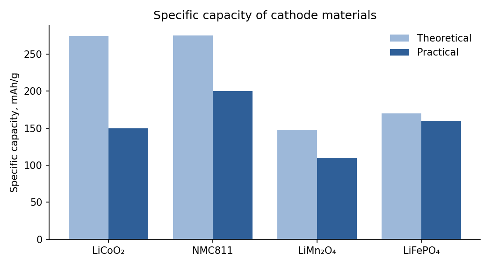

# Lithium-Ion Batteries: Chemistry, Materials and Performance

*A short technical overview prepared as a sample document for document parsing.*

## 1. History

The first rechargeable lithium cell was built in the 1970s at **Exxon** by **M. Stanley Whittingham**, who used a titanium disulfide cathode. In 1980 **John B. Goodenough** showed that lithium cobalt oxide gives a much higher voltage, and in 1985 **Akira Yoshino** at Asahi Kasei replaced the reactive lithium metal anode with carbon. The three shared the [Nobel Prize in Chemistry 2019](https://www.nobelprize.org/prizes/chemistry/2019/summary/).

*Lithium-ion batteries made portable electronics and modern electric vehicles possible by combining high energy density with long cycle life.*

### 1.1 Key milestones

**Table 1. Milestones in lithium-ion battery technology**

| **Year** | **Event** | **Organisation** | **People** |
| --- | --- | --- | --- |
| 1976 | Lithium metal / TiS₂ rechargeable cell | Exxon | M. S. Whittingham |
| 1980 | LiCoO₂ cathode proposed | University of Oxford | J. B. Goodenough |
| 1985 | Carbon anode, first practical Li-ion prototype | Asahi Kasei | A. Yoshino |
| 1991 | First commercial Li-ion cell | Sony | — |
| 1997 | LiFePO₄ (olivine) cathode reported | University of Texas at Austin | J. B. Goodenough, A. K. Padhi |
| 2019 | Nobel Prize in Chemistry | Royal Swedish Academy of Sciences | Goodenough, Whittingham, Yoshino |

## 2. Electrochemistry

### 2.1 Electrode reactions

During discharge, lithium ions leave the graphite anode and are inserted into the cathode. For a LiCoO₂ / graphite cell:

**Cathode:**

$$
Li_{1-x}CoO_{2} + xLi^{+} + xe^{-} \rightleftharpoons LiCoO_{2}
$$

**Anode:**

$$
Li_{x}C_{6} \rightleftharpoons C_{6} + xLi^{+} + xe^{-}
$$

### 2.2 Capacity and energy

The theoretical specific capacity of an electrode material follows from Faraday's law:

$$
Q_{th} = \frac{nF}{3.6M}
$$

where:

- n — number of electrons transferred per formula unit;
- F — Faraday constant, 96 485 C/mol;
- M — molar mass of the active material, g/mol;
- the factor 3.6 converts C/g to mAh/g.

The energy delivered by a cell is the integral of voltage over the charge passed:

$$
E = \int_{0}^{Q}V\left(q\right) dq \approx V_{avg} \cdot Q
$$

The charge or discharge current is often expressed as a **C-rate**: at 1C a cell is fully discharged in one hour, at 2C in 30 minutes, and in general:

$$
I = C \cdot Q_{nom},  t = \frac{1}{C} h
$$

## 3. Cathode materials

The cathode largely determines cell voltage, capacity, cost and safety. Cobalt-rich layered oxides offer high energy density, while LiFePO₄ trades capacity for thermal stability and cycle life.

**Table 2. Common cathode materials (approximate values)**

<table><thead><tr><th rowspan="2">
<strong>Structure</strong>
</th><th rowspan="2">
<strong>Material</strong>
</th><th rowspan="2">
<strong>Nominal cell voltage, V</strong>
</th><th colspan="2">
<strong>Specific capacity, mAh/g</strong>
</th><th rowspan="2">
<strong>Typical applications</strong>
</th></tr><tr><th>
<strong>Theoretical</strong>
</th><th>
<strong>Practical</strong>
</th></tr></thead><tbody><tr><td rowspan="2">
Layered oxide
</td><td>
LiCoO₂ (LCO)
</td><td>
3.7
</td><td>
274
</td><td>
≈ 150
</td><td>
Phones, laptops
</td></tr><tr><td>
NMC811
</td><td>
3.7
</td><td>
≈ 275
</td><td>
≈ 200
</td><td>
Electric vehicles
</td></tr><tr><td>
Spinel
</td><td>
LiMn₂O₄ (LMO)
</td><td>
3.7
</td><td>
148
</td><td>
≈ 110
</td><td>
Power tools
</td></tr><tr><td>
Olivine
</td><td>
LiFePO₄ (LFP)
</td><td>
3.2
</td><td>
170
</td><td>
≈ 160
</td><td>
EVs, stationary storage
</td></tr></tbody></table>

image content

Theoretical and practical specific capacity of cathode materials

*Figure 1. Theoretical vs practical specific capacity of cathode materials.*

## 4. Computing theoretical capacity

The formula from Section 2.2 in Python:

F = 96485.0  # Faraday constant, C/mol

def theoretical\_capacity(molar\_mass: float, n: int = 1) -> float:

return n \* F / (3.6 \* molar\_mass)  # mAh/g

print(f"LiFePO4: {theoretical\_capacity(157.76):.1f} mAh/g")  # 169.9 mAh/g

## 5. Summary

1. Lithium-ion technology was developed between 1976 and 1991 and commercialised by Sony.
2. A cell consists of:
    - a graphite anode;
    - a transition-metal oxide or phosphate cathode;
    - a liquid electrolyte with a lithium salt, usually LiPF₆.
3. Cathode choice trades off energy density, cost, safety and cycle life.

### Glossary

**Specific capacity** — charge stored per unit mass of active material, mAh/g.

**Intercalation** — reversible insertion of ions into a host crystal structure without destroying it.

**SEI** — solid electrolyte interphase, a passivation layer formed on the anode during the first cycles.