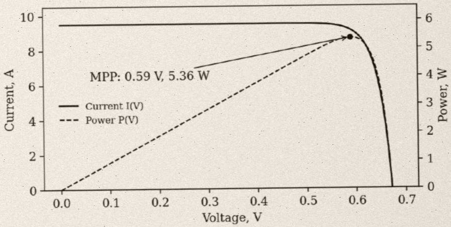

# Silicon Solar Cells: Principles and Performance

Internal technical note, sample scanned document for document parsing

## 1. History

The first practical silicon solar cell was demonstrated in 1954 at Bell Labs by Daryl Chapin, Calvin Fuller and Gerald Pearson; it converted about 6% of sunlight into electricity. Early cells powered satellites such as Vanguard 1 (1958). In 1961 William Shockley and Hans-Joachim Queisser derived the detailed-balance limit for a single p-n junction, which is about 33.7% for a band gap of 1.34 eV under standard sunlight.

## 2. Device equations

## 2.1 Current-voltage characteristic

An illuminated solar cell is modelled as a current source in parallel with a diode:

$$
I = I _ {L} - I _ {0} \Bigl [ \exp \left(\frac {q V}{n k T}\right) - 1 \Bigr ]
$$

Setting $I = 0$ gives the open-circuit voltage:

$$
V _ {o c} = \frac {n k T}{q} \ln \left(\frac {I _ {L}}{I _ {0}} + 1\right)
$$

## 2.2 Efficiency

The fill factor $FF$ and the power conversion efficiency $\eta$ are defined as:

$$
F F = \frac {P _ {m a x}}{V _ {o c} I _ {s c}}, \quad \eta = \frac {F F \cdot V _ {o c} \cdot I _ {s c}}{P _ {i n}}
$$

where:

\- $I_{\mathrm{L}}$ — photogenerated current, approximately equal to the short-circuit current $I_{\mathrm{sc}}$;

\- $I_{0}$ — dark saturation current of the diode;

\- $n$ — ideality factor; $k$ — Boltzmann constant; $T$ — cell temperature;

\- $P_{\text{in}}$ — incident light power, 1000 W/m$^{2}$ under standard test conditions (STC).

Figure 1. Calculated $I - V$ and $P - V$ curves of a $156\mathrm{mm}$ silicon cell ($I_{L} = 9.5\mathrm{A}$, $I_{0} = 5\cdot 10^{-11}\mathrm{A}$, $n = 1$, $T = 300\mathrm{K}$).

## 3. Photovoltaic technologies

Table 1. Comparison of photovoltaic technologies (approximate values) ${}^{1}$

<table><tr><td rowspan="2">Group</td><td rowspan="2">Technology</td><td colspan="2">Absorber</td><td rowspan="2">Typical module efficiency, %</td><td rowspan="2">Market status</td></tr><tr><td>Band gap, eV</td><td>Band gap type</td></tr><tr><td rowspan="2">Crystalline silicon</td><td>Monocrystalline Si</td><td>1.12</td><td>indirect</td><td>20 – 23</td><td>dominant</td></tr><tr><td>Multicrystalline Si</td><td>1.12</td><td>indirect</td><td>16 – 18</td><td>declining</td></tr><tr><td rowspan="3">Thin film</td><td>CdTe</td><td>1.45</td><td>direct</td><td>18 – 19</td><td>utility scale</td></tr><tr><td>CIGS</td><td>1.0 – 1.7</td><td>direct</td><td>14 – 17</td><td>niche</td></tr><tr><td>Amorphous Si</td><td>1.7</td><td>amorphous</td><td>6 – 9</td><td>legacy</td></tr><tr><td>Emerging</td><td>Perovskite</td><td>1.5 – 1.6</td><td>direct</td><td>—</td><td>early commercial</td></tr></table>

## 4. Worked example

A monocrystalline cell of  $156 \times 156$  mm under STC has:

1 $V_{\mathrm{oc}} = 0.67\mathrm{V}$ and $I_{\mathrm{sc}} = 9.5\mathrm{A}$;

2 fill factor $FF = 0.80$, so $P_{\max} = 0.80 \times 0.67 \times 9.5 \approx 5.1 \mathrm{~W}$;

3 incident power  $P_{in} = 1000 \, W/m^{2} \times 0.0243 \, m^{2} \approx 24.3 \, W$ ;

4 efficiency $\eta \approx 5.1 / 24.3\approx 21\%$

## 5. Conclusions

• Crystalline silicon dominates the market thanks to mature manufacturing and low cost.

\- Efficiency is limited by the band gap: the Shockley–Queisser limit is about 33.7%.

• Tandem cells, e.g. perovskite on silicon, can exceed the single-junction limit.

$^{1}$  Efficiency figures are typical values for commercial products and vary between manufacturers.